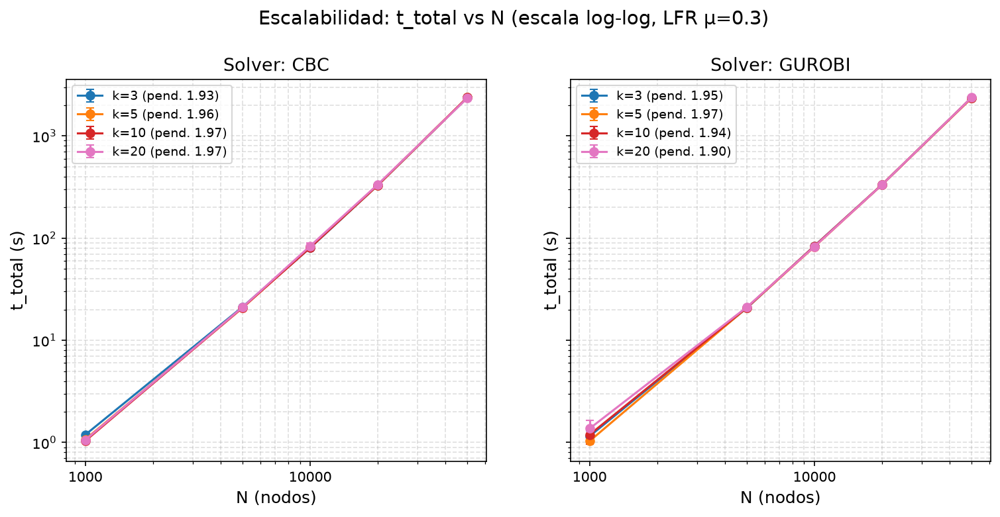
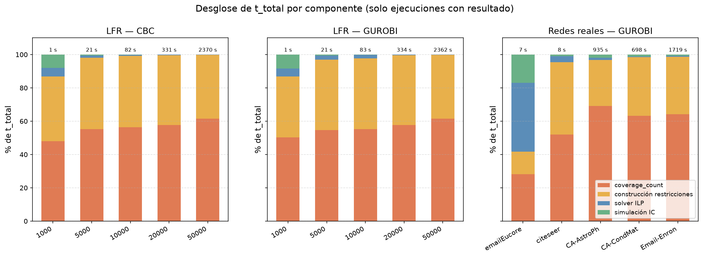
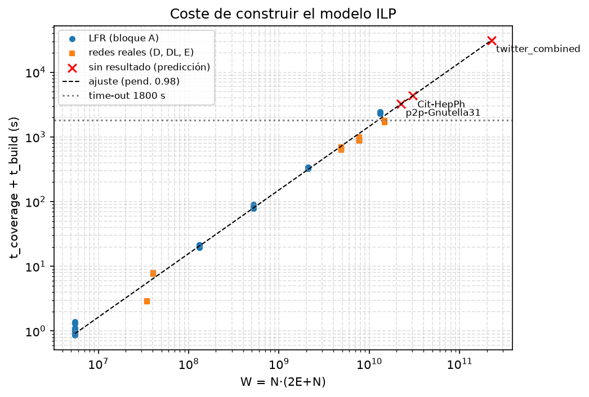
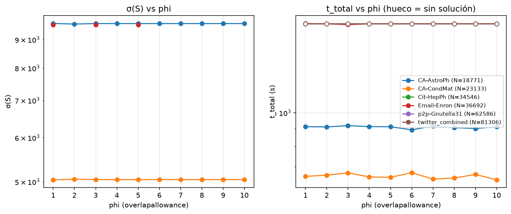

# Reunión Cordón 04

*José Ruiz - 9 de noviembre de 2026*

## 1. Qué he hecho desde la última reunión

Tareas que salieron de la reunión 03:

| Tarea | Estado | Dónde |
|---|---|---|
| Añadir k = 10 y 15 en las tablas de redes reales | Hecho | Bloque D → `datos/table_methods_comparison.csv` |
| Estudio de φ (1–10) con redes grandes reales | Hecho | Bloque E → `datos/table_phi.csv`, `figuras/fig_phi.png` |
| Límite de overlapallowance / timeout general | Hecho | `--max-iter` (por defecto 10) y `--global-timeout` en `DCIIM.py` |
| Seguir escribiendo literatura | En curso | `tfm.tex` |

Experimentos lanzados:

- **Bloque D:** DCIIM frente a Greedy, HCIM y α-HCIM en 12 redes (6 pequeñas + 6 de SNAP), k = 3, 4, 5, 10 y 15, timeout de 300 s.
- **Bloque DL:** DCIIM en las 6 redes SNAP con el timeout ampliado a 1800 s.
- **Bloque E:** φ fijo de 1 a 10, k = 3, en las 6 redes SNAP, con timeout global de 1800 s.

Redes SNAP utilizadas:

| Red | N | E |
|---|---|---|
| CA-AstroPh | 18 771 | 198 050 |
| CA-CondMat | 23 133 | 93 439 |
| Cit-HepPh | 34 546 | 420 877 |
| Email-Enron | 36 692 | 183 831 |
| p2p-Gnutella31 | 62 586 | 147 892 |
| twitter_combined | 81 306 | 1 342 296 |

>**Nota:** no he modificado el algoritmo de DCIIM ni el de los baselines; los tiempos son los del código original de Motaz. Lo que he añadido es: CLI, medición del tiempo por fases, `--max-iter`, `--global-timeout` y un evaluador σ(S) común para que todos los métodos se comparen con el mismo modelo IC.

---

## 2. Escalabilidad: cómo crece el tiempo con N



Pendientes del ajuste log-log (`datos/table_loglog_slopes.csv`), en grafos LFR con μ = 0,3 y N de 1000 a 50 000:

| Solver | k = 3 | k = 5 | k = 10 | k = 20 |
|---|---|---|---|---|
| CBC | 1,93 | 1,96 | 1,97 | 1,97 |
| Gurobi | 1,95 | 1,97 | 1,94 | 1,90 |

>**Observación:** en la reunión anterior hablamos de crecimiento exponencial. Al ajustarlo en log-log sale una **recta de pendiente ≈ 2**, así que el crecimiento es **polinómico, aproximadamente cuadrático (O(N²))**: duplicar N multiplica el tiempo por ~4. El resultado práctico es el mismo, porque a partir de ~50 000 nodos no es viable.

>**Observación:** la pendiente **no depende de k ni del solver**. Las curvas de CBC y Gurobi prácticamente se solapan, lo que ya apuntaba a que el ILP no es lo que limita.

---

## 3. Dónde se va el tiempo (cuello de botella)



Porcentaje de `t_total` por fase, solo en ejecuciones que terminan (`datos/table_time_breakdown.csv`):

| Instancia | t_total | coverage_count | Restricciones | Solver ILP | Simulación IC |
|---|---|---|---|---|---|
| LFR N=1000 | 1 s | 50 % | 37 % | 5 % | 8 % |
| LFR N=10000 | 83 s | 55 % | 43 % | 2 % | 0,1 % |
| LFR N=50000 | 2362 s | **62 %** | **38 %** | 0,1 % | 0,0 % |
| CA-AstroPh | 935 s | **69 %** | **28 %** | 1,4 % | 1,9 % |
| CA-CondMat | 698 s | **63 %** | **35 %** | 0,4 % | 1,2 % |
| Email-Enron | 1719 s | **64 %** | **35 %** | 0,6 % | 0,8 % |

>**Hallazgo principal:** el cuello de botella **no es el ILP ni Monte Carlo**. Es **construir el modelo en Python**: `coverage_count` más la generación de restricciones se llevan **el 97–99 % del tiempo** en todas las redes con N ≥ 3000. El solver se queda por debajo del 4 % y la simulación IC por debajo del 2 %.

>Esto rebate lo que teníamos pensado de la reunión 02, donde se suponía que el coste estaba en Monte Carlo.

>**Por qué pasa:** `cover()`, `coverage_count` y el bucle de restricciones vienen del repositorio original de Motaz y están escritos con bucles de Python, sin vectorizar. Para cada patrón recorren todas las transacciones, con un coste O(N·Σ|T|).

>**Excepción:** emailEuCore es una red pequeña pero muy densa (N = 1005, E = 16 706), así que el ILP pesa un 41 %. Aun así tarda solo 7 s en total.

---

## 4. Modelo de coste y redes grandes sin resultado



Ajusté el tiempo de construcción frente a la carga `W = N·(2E + N)`, que es aproximadamente el número de comprobaciones que hace `cover()`. Sale **t ∝ W^0,98**, es decir, prácticamente lineal en W.

Predicción frente a lo observado (`datos/table_cost_model.csv`):

| Red | Previsto (s) | Observado (s) | ¿Cabe en 1800 s? |
|---|---|---|---|
| CA-CondMat | 716 | 661 | Sí |
| CA-AstroPh | 1138 | 894 | Sí |
| Email-Enron | 2145 | 1736 | En el límite |
| p2p-Gnutella31 | **3220** | — | No |
| Cit-HepPh | **4324** | — | No |
| twitter_combined | **31 046** | — | No |

>**Observación:** el modelo de coste explica por qué Cit-HepPh, Gnutella y Twitter no dan resultado: harían falta entre 1,8× y 17× el presupuesto de 1800 s **solo para construir el modelo**. El solver ni siquiera llega a ejecutarse.

---

## 5. Estudio de φ en redes grandes



σ(S) y tiempo con φ fijo de 1 a 10, k = 3 y timeout de 1800 s (`datos/table_phi.csv`):

| Red | φ=1 | φ=2 | φ=3 … 10 | Tiempo |
|---|---|---|---|---|
| CA-AstroPh | 9618 | 9598 | 9616 (todos iguales) | ~910 s, plano |
| CA-CondMat | 5041 | 5053 | 5046 (todos iguales) | ~655 s, plano |
| Email-Enron | 9572 | tout | 9563 con φ = 3 y 5; tout con el resto | ~1790–1800 s |
| Cit-HepPh | tout | tout | tout | 1800 s |
| p2p-Gnutella31 | tout | tout | tout | 1800 s |
| twitter_combined | tout | tout | tout | 1800 s |

>**Limitación del diseño:** con **k = 3**, la restricción de solapamiento solo actúa si **φ < 3**. Las restricciones del ILP son:
```
(1)  Σ_j y_j · cover(T_i, P_j) ≤ φ     para cada transacción T_i
(2)  Σ_j y_j = k
```

>Si solo se eligen 3 semillas, una transacción puede estar cubierta como mucho por 3. Por tanto, con φ ≥ 3 la restricción (1) es redundante y el ILP es exactamente el mismo problema. Que σ(S) sea idéntica de φ = 3 a φ = 10 es **una consecuencia de usar k = 3, no un resultado experimental**. En la práctica, este bloque solo estudia el efecto de φ en **φ = 1 y φ = 2**, donde la variación es < 0,3 %.

>**Lo que sí muestra el bloque E:** el **tiempo no depende de φ** en ningún caso, y las redes que fallan lo hacen con cualquier φ. Esto encaja con que el coste está en construir el modelo, que es igual para cualquier φ.

>**Sobre la hipótesis de la reunión anterior** (que en redes grandes el modelo no encontraría solución factible): la **hipótesis queda sin comprobar** en esas redes porque el modelo **no llega a construirse** dentro del tiempo.

>**Email-Enron:** la alternancia optimal/timeout parece depender de φ, pero no es así. Todos los tiempos están en ~1790–1800 s, así que es ruido de ejecución justo en el límite.

>**Conclusión y propuesta:** φ **no limita la escalabilidad en tiempo**. Lo que la limita es el tamaño de la red (sección 4). Para estudiar el efecto de φ sobre la calidad y la factibilidad habría que **repetir el bloque E con k mayor** (p. ej. k = 10 o 15), de forma que φ = 1…10 sea siempre una restricción efectiva.

---

## 6. Comparación con Greedy, HCIM y α-HCIM (k = 3…15)

Bloque D: una semilla, timeout de 300 s, σ(S) evaluada con el mismo IC para todos. Tabla completa en `datos/table_methods_comparison.csv`.

### Redes pequeñas

| Red | k | DCIIM σ (CPU) | Greedy σ (CPU) | HCIM σ (CPU) | α-HCIM σ (CPU) |
|---|---|---|---|---|---|
| karate | 10 | 15 (0,03 s) | 15 (4,5 s) | 15 (0,4 s) | 15 (0,6 s) |
| karate | 15 | 19 (0,04 s) | **20** (7,4 s) | **20** (0,7 s) | 19 (0,8 s) |
| dolphins | 10 | 19 (0,06 s) | 19 (11,4 s) | 18 (1,1 s) | 18 (0,7 s) |
| dolphins | 15 | **25** (0,06 s) | 24 (20,1 s) | 24 (1,4 s) | 24 (1,0 s) |
| Books | 10 | **37** (0,07 s) | 35 (42,9 s) | 32 (2,7 s) | 34 (3,9 s) |
| Books | 15 | **42** (0,09 s) | 41 (71,1 s) | **42** (4,1 s) | **42** (4,3 s) |
| football | 10 | 41 (0,08 s) | 41 (52,7 s) | **42** (3,6 s) | **42** (3,8 s) |
| football | 15 | **52** (0,11 s) | 48 (86,9 s) | **52** (4,8 s) | **52** (5,4 s) |

### Redes medianas

| Red | k | DCIIM σ (CPU) | Greedy | HCIM σ (CPU) | α-HCIM σ (CPU) |
|---|---|---|---|---|---|
| emailEuCore | 10 | 709 (6,9 s) | tout | 709 (239 s) | tout |
| emailEuCore | 15 | **714** (13,3 s) | tout | tout | tout |
| citeseer | 10 | **75** (7,9 s) | tout | 62 (17,8 s) | 63 (54,8 s) |
| citeseer | 15 | **90** (7,9 s) | tout | 75 (20,8 s) | 76 (102,6 s) |

>**Observación:** en redes pequeñas la calidad es **equivalente** entre los cuatro métodos. Las diferencias son de ±1 nodo: el bloque D usa una sola semilla y σ se estima con 100 simulaciones Monte Carlo, y en el bloque B la desviación típica de σ entre réplicas fue de 0,6–3,5 nodos. Donde sí hay diferencia clara es en el tiempo: DCIIM es **2–3 órdenes de magnitud más rápido** que Greedy (football k = 15: 0,11 s frente a 86,9 s).

>**citeseer** es el caso más claro: DCIIM obtiene un **+20 % de σ** frente a HCIM y α-HCIM (+13–15 nodos, muy por encima del ruido), en menos tiempo, y Greedy no termina. En emailEuCore la σ es la misma que la de HCIM, pero DCIIM tarda 6,9 s frente a 239 s, y con k = 15 es el único que termina.

>**Redes SNAP (N ≥ 18 000):** con 300 s **no termina ningún método**, tampoco los baselines. No es un problema exclusivo de DCIIM. Con 1800 s, DCIIM sí resuelve CA-AstroPh y CA-CondMat (sección 5).

>Email-Enron da timeout en el bloque D (300 s) y termina en DL/E (1800 s); la única diferencia es el presupuesto de tiempo.

---

## 7. Otros resultados

### Efecto de μ (`datos/table_mu.csv`)

| μ | 0,1 | 0,3 | 0,5 | 0,7 | 0,9 |
|---|---|---|---|---|---|
| t_total (s) | 21,2 | 21,7 | 21,2 | 21,7 | 21,2 |
| σ(S) | 91 | 86 | 100 | 104 | 99 |

>Como acordamos, μ queda fuera de las figuras. El tiempo no cambia (variación del 2 %). Varía σ porque cada μ es un grafo distinto, por lo que no es comparable.

### Incrementos de overlapallowance (`datos/report_overlap_increments.txt`)

>Solo hizo falta subir overlapallowance en **karate**: +2 con k = 10 y +4 con k = 15. En ninguna otra red. Con `--max-iter 10` nunca se llega al límite, lo que justifica dejar ese valor por defecto.

---

## 8. Preguntas a decidir

- ¿Vectorizo la construcción del modelo?
- ¿Repito el estudio de φ con k = 10 o 15 en CA-AstroPh y CA-CondMat? Con k = 3 solo se prueban de verdad φ = 1 y 2 (sección 5).
- ¿Vale como justificación de `--max-iter 10` que nunca se agota, y de 1800 s que es un presupuesto práctico de 30 minutos por k?

